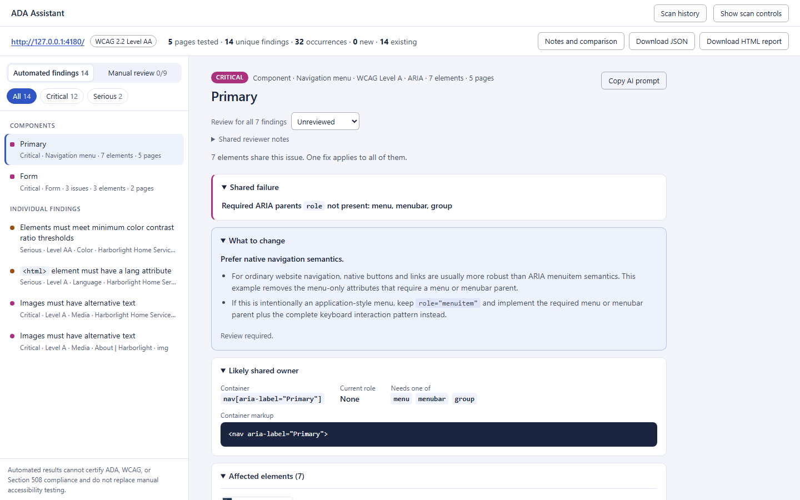
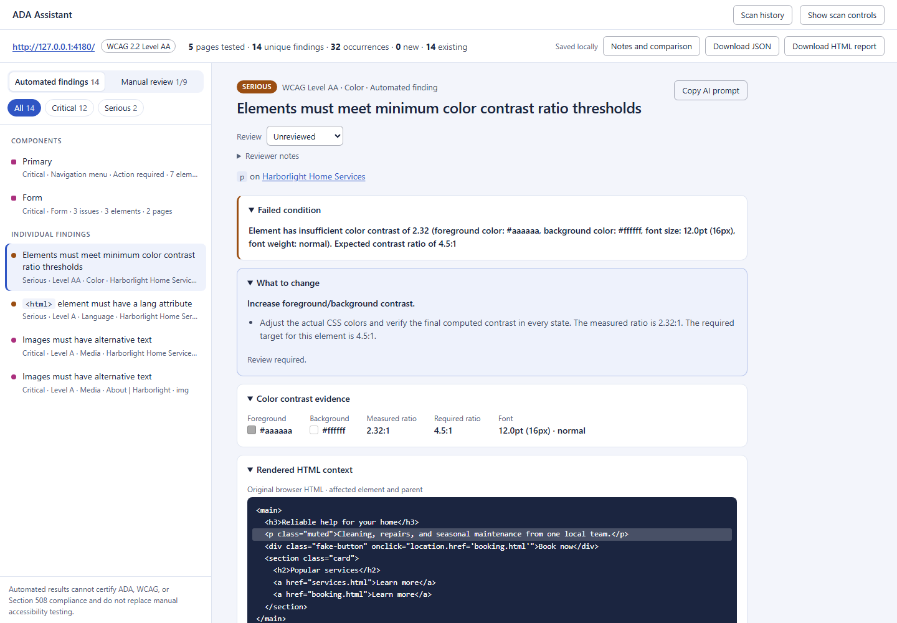

# ♿ ADA Remediation Assistant

Identify common accessibility issues on a website, inspect the evidence behind each finding, and get practical guidance for remediation. The tool is designed to support developers and QA engineers as they review accessibility issues and track fixes during development.



> Automated scanning cannot certify ADA, WCAG, or Section 508 compliance. It does not replace keyboard testing, screen-reader testing, usability review, or evaluation by accessibility professionals and people with disabilities.

## Try it in two minutes

**Prerequisite:** Node.js 20 or newer.

Clone your repository and open the project folder:

```bash
git clone https://github.com/Pragati4566/Accessibility-Test-Strategy.git
cd Accessibility-Test-Strategy/accessibility-test-strategy-master
npm install
npx playwright install chromium
```

Start the demo site and dashboard in separate terminals.

**Terminal 1 — demo website**

```bash
npm run demo
```

The demo site runs at `http://127.0.0.1:4180`.

**Terminal 2 — dashboard**

```bash
npm run ui
```

The dashboard runs at `http://127.0.0.1:4173`.

Then:

1. Open [http://127.0.0.1:4173](http://127.0.0.1:4173).
2. Enter `http://127.0.0.1:4180/` as the target URL.
3. Enable **Crawl same-origin pages** if you want to scan linked pages on the demo site.
4. Select **Scan site** to start the scan.

## What it provides

- **Actionable findings:** Review the failed condition, supporting evidence, rendered HTML, and an element screenshot where available.
- **Component-based grouping:** Related issues can be grouped so repeated instances are easier to review together.
- **Remediation guidance:** Each finding provides practical suggestions and verification steps to help plan a fix.
- **AI-ready prompts:** Copy a structured prompt with the issue details and checks for use with a coding assistant. No AI service is called by the application itself.
- **Review workflow:** Classify findings as requiring action, accepted risk, or false positive, and record manual checks separately.
- **Scan history and comparison:** Compare scan results over time to identify new, unresolved, and resolved findings.
- **Report exports:** Export findings in supported formats, including JSON, HTML, and SARIF.
- **Interactive and authenticated flows:** Where supported, scan additional UI states such as menus, tabs, dialogs, carousels, and pages behind a login.



## Scan your own site

Build the CLI before using it:

```bash
npm run build
```

Use the command that matches your target:

| Use case | Command |
| --- | --- |
| Scan a single page | `node dist/cli.js scan-url https://example.com/page` |
| Crawl a website | `node dist/cli.js scan-site https://example.com --max-pages 25` |
| Scan a local development server | `node dist/cli.js scan-url http://localhost:3000` |
| Scan HTML files in a repository | `node dist/cli.js scan-repo .` |
| Scan a page using saved login state | `node dist/cli.js scan-url URL --storage-state auth.json` |

You can save an HTML report with `--format html --output report.html`. The CLI may also support WCAG target selection (`--wcag-level A`, `AA`, or `AAA`) and other options. Run the CLI help or consult the project guide for the options available in your version.

See the [project guide](docs/GUIDE.md) for scan methods, command options, reports, remediation workflows, baselines, and history.

## Use it in continuous integration

Accessibility scans can be added to a CI workflow to flag serious issues before changes are merged. For example, if supported by the CLI configuration:

```bash
node dist/cli.js scan-repo . --fail-on serious
```

A baseline can help an existing project focus on new findings rather than blocking on every previously known issue. See the [CI testing guide](docs/GUIDE.md#testing-method-7-test-in-ci-or-a-pull-request) and the [GitHub Actions example](docs/github-actions.yml).

## What automated scans cannot do

- They cannot prove full compliance with ADA, WCAG, or Section 508 requirements.
- They cannot reliably decide whether alternative text, labels, instructions, or headings make sense in the page's context.
- They cannot replace manual keyboard, screen-reader, and usability testing.
- Remediation suggestions need human review, and changes must be retested to check for regressions.

Only scan websites, applications, and repositories you own or are authorized to test.

## Privacy and local data

- URL scans make browser requests to the pages being tested.
- Scan history may be stored under `.ada-remediation/history` in your home directory and may include page HTML or screenshots. Review it before sharing.
- Treat browser session files and authentication state as secrets. Do not commit them to a public repository.
- The application generates prompts for optional use with a coding assistant; it does not call an AI service as part of that workflow.
- Review the implementation and dependencies before describing the tool as fully offline or stating that no data leaves your computer.

## Documentation

- [Project guide](docs/GUIDE.md): dashboard usage, scan methods, reports, fixes, baselines, and history.
- [GitHub Actions example](docs/github-actions.yml): an example workflow for scanning pull requests.

## Development and tests

Run the checks supported by your `package.json` scripts:

```bash
npm run check
npm run test:e2e
npm run test:a11y
```

`npm run check` is intended for type checking, unit tests, and the build; `npm run test:e2e` runs end-to-end checks in Chromium; and `npm run test:a11y` runs accessibility checks against the dashboard. Confirm the scripts in `package.json` if your local setup differs.
